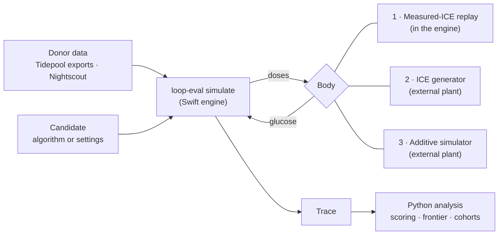

# LoopEval in one read

A newcomer's map of the project: what question it answers, the three ways it simulates a person, how we check
those simulations against what really happened, and how a candidate algorithm change earns a verdict. Each section
ends with where the detail lives.

## The question

**What would this dosing change have done to these people?** The change can be to the algorithm, such as a new
retrospective-correction rule, or to the settings, such as a lower ISF in the evenings. The aim is a number, with
uncertainty, before anyone runs the change on their body.

The score always has two sides: **time in range (70–180 mg/dL) up, and time below 54 mg/dL down.** A change that buys
one by spending the other hasn't improved anything. It has only moved along the aggressiveness trade-off, which any
user can already do by turning their insulin up or down.

## The pieces



- **The controller is always the real one.** `simulate` runs the actual dosing code: Loop's `LoopAlgorithm`, or oref
  through `OpenAPSSwift` (the algorithm Trio runs), both as git submodules. It runs every 5-minute cycle: build the
  inputs, forecast, dose, deliver through a pump model, and move on. Emulation flags reproduce the deployed app where it
  differs from the package (`docs/loop-algo-classes.md`).
- **Data.** Donor exports from Tidepool, built by the ETL in `analysis/loopeval_analysis/tidepool/`, and Nightscout
  sites fetched live. Each donor is known only by an alias; real identities, URLs and tokens stay out of the repo
  (`AGENTS.md` → Privacy). The working pool is the **pilot**: a little over 200 Tidepool donors stratified by dosing
  strategy and carb-entry habit, exported at the current ETL version. A handful of older long exports (`bddpNN`) and
  Nightscout users carry the earlier, longer-window work.
- **Output.** Each run writes a JSON trace with both arms step by step: glucose, forecast, recommendation, what was
  delivered, and IOB/COB. The Python package `analysis/loopeval_analysis/` scores traces and draws the plots.

## Three ways to simulate the body

The controller and its inputs are the same in all three. What differs is what supplies glucose after the candidate
doses.

### 1. Measured-ICE replay: replay the person

ICE (insulin counteraction effect) is everything that moved glucose that the modeled insulin did not: carbs, endogenous
production, exercise, illness, sensor artefacts, rescue carbs. Static replay measures ICE once, from the real record,
and replays it under the candidate's doses:

```
counterfactual BG[t+5] = counterfactual BG[t] + observed ICE[t] + insulin effect(candidate doses)
```

The only physiology written down is insulin action. Everything else is the person's real month, at its real times and
sizes. With the field's own doses the counterfactual reproduces the record exactly. That identity is the regression
test the engine is anchored on. Because both arms share the same day, day-to-day variation cancels from the
difference, so paired effects are measured several times more tightly than the levels.

- **Strength:** no fitted cohort and no scenario generator. The messy real world is included for free.
- **Limit:** ICE is frozen. The person's reactions stay where they were in the record even when the candidate changes
  what they would have reacted to. That matters most for rescue carbs: a candidate that prevents a low still inherits
  the carbs eaten to treat it, and one that causes a deeper low gets no extra rescue.
- **Run it:** `simulate --candidate-counterfactual`, with no plant. This is the mode documented in depth in the
  [simulator guide](simulator-guide/).

`simulate --decision-time-replay` (DTR) is a non-simulating sibling. Both arms see the identical real history at every
cycle and only recommend. It is the instrument for checking that our controller reproduces the field's decisions, not
an outcome tool.

### 2. ICE generator: learn the person

A neural generative model trained on the donor pool that produces ICE instead of replaying it. It is conditioned on
recent glucose, insulin, ICE and clock time, plus a learned per-person profile. Its behavior heads generate the
person's own carb entries, manual boluses and low treatments **in response to the simulated state**. In effect it
models the person as a second controller.

- **Strength:** reactive behavior follows the counterfactual. A candidate that prevents a low no longer inherits the
  rescue, which is exactly where static replay is weakest.
- **Limit:** a learned model interpolates. Where a candidate drives a person into states the data rarely visited, the
  model is extrapolating. A new person must be **enrolled**, with their profile fitted onto a frozen checkpoint and
  checked against held-out days, before the model can stand in for them. How well a change is predicted tracks how
  well the person's own level was enrolled.
- **Known defect:** the generated person eats back most of a carb-ratio change. Its low defense reads the insulin
  of a meal bolus as a low on the way and ignores the carbs. A carbs-aware retrain is the fix in progress.
- **Direction:** named physiology goes in one component at a time, glucose effectiveness first, then
  counter-regulation. Each comes out of the training target, so the network then learns the **residual**: ICE minus
  the modeled components (`docs/handoffs/2026-10-24-ice-mechanistic-components.md` and the reply beside it).
- **Run it:** `simulate --candidate-counterfactual --external-plant '<plant_v3 command>' --plant-behavior`. The code
  is in `analysis/loopeval_analysis/ice_gen/` (the plant is `plant_v3.py`), and the lessons are in
  `docs/ice/LESSONS.md`. Owner: the **ice** role (`docs/agents/ice.md`).

### 3. Additive simulator: compose the person

A forward patient model built from named, separately evidenced components: insulin action, glucose effectiveness,
counter-regulation, meals and their absorption, exercise, illness, the menstrual cycle, sensor models per CGM, pump
behavior, and behavior traits such as how a person eats, enters carbs, boluses and treats lows. A virtual person is a
draw of those traits, usually as a **twin** of a real donor's settings and habits.

- **Strength:** it can run situations no donor recorded, such as a person who stops entering meals or switches from
  temp basal to automatic bolus. Every factor can be switched off for an ablation. The true glucose, carbs and
  sensitivity are known, with no inherited rescue carbs.
- **Limit:** it is only as right as its components. Its match against the donors is scored on about 50 statistics
  (`docs/additive/MODEL_GUIDE.md` § 10). Its documented gaps are lows that run short, responses to settings changes
  that are damped, and tight-control twins that aren't tight. Individual twins' effects don't reproduce between
  draws, so its results are read as **category means** (by strategy, entry habit or control level), not per person.
- **Run it:** the same `--external-plant … --plant-behavior` route, from a synthetic data directory the simulator
  writes. The code is in `analysis/loopeval_analysis/patient_sim/`. Owner: the **additive** role
  (`docs/agents/additive.md`).

### How the plants plug in

Plants 2 and 3 speak the external-plant protocol (`Sources/EvalCore/Engine/ExternalPlant.swift`). Each cycle the engine
sends the doses it just delivered and the sample times it needs. The plant returns CGM values and, with
`--plant-behavior`, the person's carb entries, manual boluses and overrides. Everything upstream (the decision, the pump
model, decision timing, bolus sizing) is the unchanged engine. Two runs that differ only in the plant therefore differ
only in the body.

### Which to use

| | Measured-ICE replay | ICE generator | Additive simulator |
|---|---|---|---|
| Physiology beyond insulin | measured, frozen | learned (plus named components as they land) | named components, evidenced |
| Person's reactions | inherited from the record | generated from the simulated state | generated from traits |
| People | the real donors | enrolled donors | twins and synthetic people |
| Ranks ΔTIR and Δmean | best so far | close behind | weaker |
| Ranks Δ lows | weakly | weakly; ahead of replay on two of three donor pools | weakly |
| Size of changes | overstated: insulin response ~1.7× the field's, lows ~10× | closest, slightly under; carb-ratio changes mostly cancelled | understated ~2× |
| Situations nobody recorded | no | partly | yes |
| Cost | cheap, deterministic | GPU training, seeds, two checkpoints | CPU, seeds, many draws |

The rows on ranking and size come from the natural experiments below.

## Fidelity before frontier

No simulated outcome counts until the replay reproduces the real system. The checks build on each other
(`docs/agents/verification.md`):

1. **Deployment-faithful configuration.** For each donor: insulin model, retrospective-correction mode, the deployed
   app's emulation flags, overrides, edited carbs, and any hidden toggles. A donor export carries its required flags
   in `replay_config.json`, and `simulate` warns when a run departs from them.
2. **Forecasts match the field.** Under DTR, every recorded forecast is matched within a few mg/dL, ranked by the
   worst case, not the average. Only after that does the dose check mean anything: ≤ 0.05 U or U/hr.
3. **Identity.** Identical candidate and baseline give zero dose difference at every step, and the counterfactual
   equals the record.
4. **Golden suite.** `scripts/golden.py check` runs one short case per simulation mode and compares every trace field
   against recorded references after any engine change. Plant cases replay a recorded plant transcript, so the doses
   sent to a plant are checked too.

Each mismatch is a bug to find, not noise to average away. Most of the project's history of wrong answers came from
inputs: stale exports, dropped suspends, mis-flagged boluses, wrong RC mode. Physics was rarely the cause.

## Natural experiments: checking the simulators against real changes

Fidelity shows that the replay reproduces a person's month **as it happened**. It doesn't show that the replay
predicts what happens **when dosing changes**, and that second claim is what every candidate verdict rests on. The
donor record contains real changes made by real people, so we test against those:

- **Settings edits.** Basal, ISF, CR or target changed by at least 10% and held for two weeks or more.
- **Dosing-strategy switches.** Temp basal to automatic bolus, or back.
- **Retrospective-correction mode switches.** Too rare to test so far.

**Design.** Take 14 days before and after each event. In each window, simulate the person on both the old and the new
settings: their own, then the other window's settings applied to the controller only. The predicted change is new
minus old, averaged over the two windows; it is also scored from the pre-edit window alone, the honest "before
trying it" case. The field change is the recorded after minus before. Three guards make the comparison fair:

- A **faithful filter**: the run on the person's own settings must reproduce their field within a set tolerance.
- A **need-shift covariate**: the change in mean ICE between windows. People mostly edit settings because their needs
  changed.
- A **noise floor**: the same scoring around random dates with no event.

Each tool's predicted change is regressed on the field change. A coefficient of 1 means right-sized; below 1, the tool
overstates the change; above 1, it understates it. Replay and the generator are scored on about 500 edits from three
donor pools; the additive simulator on the first 62.

**How to read the numbers.** Field changes at these events are mostly need and noise: on the largest pool, TIR changes
at real edits are barely more spread out than at random dates. No tool predicts a single edit much better than "no
change". The comparison is about ranking and size across many events.

**Current position.**

- **Measured-ICE replay** ranks ΔTIR and Δmean best of the three, and leads on the pooled ~500 edits. It overstates
  every change: glucose moves about 1.7 times as much per unit of insulin change as in the field. On lows it is
  **weak and badly oversized**: its hypo changes are about ten times the field's, and it ranks them only weakly. The
  likely cause is the frozen rescue carbs described above.
- **The ICE generator** gets the size of changes closest to the field, slightly under. Its ranking is close to
  replay's: ahead on lows in two of the three donor pools, behind on the largest, and worst where the person's level
  was poorly enrolled. Its predictions are compressed, and it cancels most of a carb-ratio change (the defect above).
- **The additive simulator** understates changes about twofold. It also gets the field's control-level pattern wrong:
  in the field, people already in tight control gain no TIR and more lows from extra insulin, while everyone else gains
  TIR at no cost in lows (`docs/handoffs/2026-10-24-additive-response-by-control-level.md`).

The practical rule is to **rank candidates on ΔTIR from replay, and never accept or reject a candidate on replay's
lows delta alone.** Read the size of a lows change from the generator, and research's synthetic worlds where the true
answer is known. No tool yet ranks lows changes reliably, so a lows verdict needs agreement across tools. Evidence:
`docs/handoffs/2026-10-15-frontier-replay-predicts-change.md`, ledger entries M11 and E56, and `docs/ice/LESSONS.md`
143–145.

## How a candidate earns a verdict

The **frontier** role owns this. The method is in [FRONTIERS.md → Scoring](FRONTIERS.md), and the record of every
candidate tried, failed ones included, is the [candidate ledger](candidates/README.md).

1. **Write it down first.** Add a ledger entry with status `planned` before running. Where a run could tempt a story
   after the fact, register the prediction and the bar it must clear before the numbers land.
2. **Express it in the forecast.** Loop is a feedback controller. Cutting its output gets compensated on the next
   cycle, because the forecast still says high. Changing what it believes (ISF, an offset, a model term) is what lasts.
3. **Beat the dial, not the stock point.** Every candidate is compared against the stock algorithm swept along the
   **insulin-needs dial** (`--candidate-insulin-needs f`: basal ×f, ISF ÷f, CR ÷f), which is what any user can already
   do with an override. A change matters only if it reaches a point that is better on both axes than some setting on
   that curve, near the person's real operating point. That is **lift**, or per-setting dominance. Movement along the
   curve is a trade, not an improvement.
4. **Run it on the cohort, paired.** The standard harness replays the pilot donors deployment-faithfully: 28 days each,
   manual boluses as given, the candidate against the baseline on the same windows. It reports the cohort effect with
   person-bootstrap CIs, the worst donors, and the split by **typical glucose** (tight, middle, high). Who gains often
   differs by control level. A multi-donor result is the only headline; a single-donor or single-window win is a
   hypothesis.
5. **Cross-check across tools.** Use replay for ΔTIR ranking and the generator for the size of the lows change; a
   lows verdict needs the tools to agree. Use the additive
   simulator for situations no donor recorded, such as reduced carb entry or a strategy switch, and for ablations,
   reading its numbers as category means.
6. **Robustness.** Run the full date range, the operating band, both directions of the dial, the alternative
   manual-bolus handling, and ±10% patient sensitivity. Check IOB at the moment of crossing 54 alongside t<54.

Candidates that pass go to the upstream algorithm as opt-in experiments. Guard + runway is in the LoopAlgorithm
experiments PR and landing in Loop's development branch. It is a volatility-aware lower forecast band, a post-low cut
to retrospective correction, and a correction reserve sized to what Loop could still take back. While it lands, its
constants are frozen, and new candidates stack on top of it.

## Known confounds to keep in mind

- **Rescue carbs** are inherited in replay. This biases against candidates that prevent lows and inflates replay's
  lows deltas.
- **Compression lows** and the CGM's 40 mg/dL floor inflate absolute t<54 in every arm. Deltas hold; absolute values
  are overstated.
- **Insulin delivery is one-sided.** A controller can withhold insulin but never remove it. At the moment of most lows,
  delivery is already zero.
- **Meal announcement** outweighs any algorithm change measured so far.
- **Recommendation is not delivery.** Dose plots must say which stream they show.

## Who works on what

The repo is worked by several agent roles, each in its own worktree with an overlay in `docs/agents/`:

| Role | Job |
|---|---|
| simulator | Engine, CLI, analysis package, fidelity |
| frontier | Candidate verdicts and the ledger |
| ice | The ICE generator |
| additive | The additive simulator |
| eda | Observational study of the donor data |
| trio | oref and Trio fidelity, and Loop vs oref |
| research | Literature, and synthetic oracle worlds where the true answer is known |

Shared code lands on `main`. Findings one role hands another go in `docs/handoffs/`. Experiment outputs live under
`runs/`, a symlink outside the repo. `AGENTS.md` has the working rules.

## Reading order

1. This page, then [GOALS.md](GOALS.md) for what the project is currently trying to find.
2. The [simulator guide](simulator-guide/) for how measured-ICE replay works, section by section.
3. [FRONTIERS.md](FRONTIERS.md) and the [candidate ledger](candidates/README.md) for how verdicts are reached and what
   has been tried.
4. [verification.md](agents/verification.md) and [CASE_STUDIES.md](CASE_STUDIES.md) for checking that a replay, or a
   candidate, is doing what it should.
5. The ice and additive overlays and [`docs/additive/`](additive/) for the two plant-based simulators.
